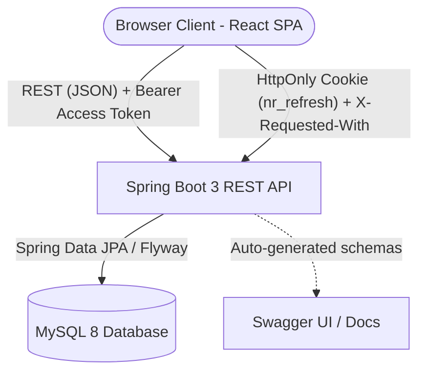
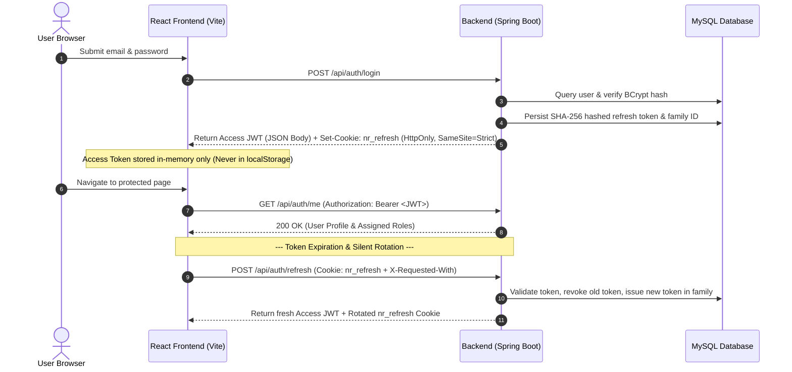
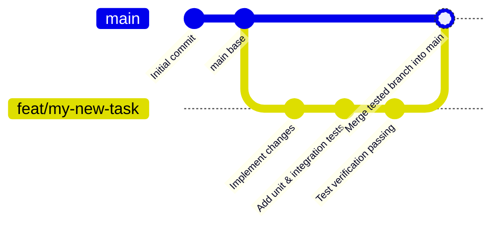

# 🛡️ NextRisk AI (TRUVIA)

> **NextRisk AI** is an enterprise-grade cybersecurity risk management and compliance platform unifying **Governance, Risk, and Compliance (GRC)**, **Security Operations (SOC)**, and **Penetration Testing** with automated risk calculation and AI-driven predictive remediation.

[](https://openjdk.org/)
[](https://spring.io/projects/spring-boot)
[](https://spring.io/projects/spring-security)
[](https://react.dev/)
[](https://vitejs.dev/)
[](https://www.mysql.com/)
[](https://www.docker.com/)
[](https://vitest.dev/)

---

## 📑 Table of Contents

- [Overview & Vision](#-overview--vision)
- [Documentation & Master Roadmap](#-documentation--master-roadmap)
- [Architecture & Tech Stack](#-architecture--tech-stack)
- [Repository Structure](#-repository-structure)
- [Authentication & Security Architecture](#-authentication--security-architecture)
- [Role-Based Access Control (RBAC)](#-role-based-access-control-rbac)
- [API Reference](#-api-reference)
- [Database Schema & Migrations](#-database-schema--migrations)
- [Getting Started](#-getting-started)
  - [Prerequisites](#prerequisites)
  - [1. Environment Configuration](#1-environment-configuration)
  - [2. Database with Docker Compose](#2-database-with-docker-compose)
  - [3. Backend Launch (Host or Container)](#3-backend-launch-host-or-container)
  - [4. Frontend Launch](#4-frontend-launch)
  - [5. Provisioning the Initial Admin](#5-provisioning-the-initial-admin)
- [Testing](#-testing)
  - [Frontend Test Suite](#frontend-test-suite)
  - [Backend Test Suite](#backend-test-suite)
  - [API Smoke Testing Script](#api-smoke-testing-script)
- [Development & Contribution Workflow](#-development--contribution-workflow)
- [Roadmap & Known Scope](#-roadmap--known-scope)

---

## 🎯 Overview & Vision

Modern cybersecurity teams often suffer from disjointed tooling: GRC analysts track risks in spreadsheets, SOC engineers analyze telemetry in silos, and penetration testers output point-in-time PDFs. 

**NextRisk AI bridges this gap by providing:**
1. **Unified Risk Register**: Live risk calculation connecting active vulnerabilities and infrastructure assets to business impact.
2. **Dynamic Algorithmic Scoring**: Real-time score recalculation factoring in asset criticality, CVSS v3 severity, threat likelihood, and control effectiveness.
3. **Multi-Framework Compliance**: Continuous control mapping across ISO/IEC 27001, NIST CSF, and SOC 2.
4. **Security Operations & Incident Triage**: Correlating live incidents directly to affected risk entries.
5. **AI-Driven Remediation**: Predictive guidance and actionable playbooks generated to mitigate critical exposures.

> ℹ️ **Current Status:** Foundation + **Phase 1: Authentication Core & RBAC MVP** is fully implemented and tested. See the [Master Roadmap PDF](docs/NextRisk_AI_Master_Roadmap_Mohamed_Shosha.pdf) and [Task Backlog](docs/TASK_BACKLOG.md) for the 96-task development plan.

---

## 📚 Documentation & Master Roadmap

All formal specifications, architectural audits, and development roadmaps are centralized inside the [`docs/`](docs/) directory:

| Document | Format | Description |
|---|---|---|
| **[NextRisk AI Master Roadmap](docs/NextRisk_AI_Master_Roadmap_Mohamed_Shosha.pdf)** | `PDF (25 Pages)` | Executive-grade sprint plan with platform sitemap, functional matrix, and 96 granular tasks. |
| **[Interactive Implementation Plan](docs/NextRisk_AI_Implementation_Plan_Mohamed_Shosha.html)** | `HTML (Web)` | Print-optimized web version of the master implementation plan. |
| **[Task Backlog](docs/TASK_BACKLOG.md)** | `Markdown` | 96 engineering tasks across 10 Sprints (Phases 0–9) formatted for Jira / Linear migration. |
| **[Project Audit & Handover Report](docs/PROJECT_STATUS_AND_HANDOVER.md)** | `Markdown` | Comprehensive audit covering repository health, APIs, database, and safe pause checklist. |
| **[Architecture Status](docs/ARCHITECTURE_STATUS.md)** | `Markdown` | Detailed architectural inventory of implemented vs. planned subsystems. |
| **[Security Findings & Hardening](docs/SECURITY_FINDINGS.md)** | `Markdown` | Security audit matrix, threat model, and hardening recommendations. |
| **[Local Development Guide](docs/LOCAL_DEVELOPMENT_GUIDE.md)** | `Markdown` | Step-by-step developer onboarding for host and containerized workflows. |
| **[Original Specification](docs/plan.md)** | `Markdown` | Initial product architecture and phase definitions. |

---

## 🏗 Architecture & Tech Stack



### Technology Matrix

| Layer | Technology | Key Capabilities |
|---|---|---|
| **Backend** | Java 21, Spring Boot 3.3.5 | Spring Web, Spring Data JPA, Spring Validation, Lombok |
| **Security** | Spring Security 6 | Stateless JWT Resource Server, BCrypt (strength 12), Custom Token Rotation |
| **Frontend** | React 18, Vite 5.4 | React Router 6, Axios interceptors, responsive dark/light UI |
| **Database** | MySQL 8.0 | Dockerized, utf8mb4, strict validation, Flyway schema migration |
| **API Docs** | SpringDoc OpenAPI 2.6 | Interactive Swagger UI on `/swagger-ui.html` |
| **Testing** | Vitest 2.1, RTL, JUnit 5 | 36 frontend test cases, Spring Security test slice, integration tests |

---

## 📂 Repository Structure

```text
nextrisk/
├── backend/                             # Spring Boot 3 Java application
│   ├── src/main/java/com/nextrisk/
│   │   ├── auth/                        # Auth controllers, services, DTOs, models
│   │   │   ├── controller/              # AuthController, AdminProbeController
│   │   │   ├── dto/                     # LoginRequest, RegisterRequest, UserResponse, AuthResponse
│   │   │   ├── model/                   # User, Role, RoleName, RefreshToken
│   │   │   ├── repository/              # UserRepository, RoleRepository, RefreshTokenRepository
│   │   │   └── service/                 # AuthService, RefreshTokenService, RefreshCookieFactory
│   │   ├── config/                      # SecurityConfig, JwtConfig, OpenApiConfig, CorsConfig
│   │   ├── exception/                   # GlobalExceptionHandler, ApiException
│   │   └── security/                    # JwtAuthenticationConverter, UserPrincipal
│   ├── src/main/resources/
│   │   ├── application.yml              # Base Spring configuration
│   │   └── db/migration/                # Flyway versioned SQL scripts (V1, V2, V3)
│   ├── Dockerfile                       # Multi-stage container build
│   └── pom.xml                          # Maven build dependencies
│
├── frontend/                            # React 18 Single Page Application
│   ├── src/
│   │   ├── components/                  # Navbar, Sidebar, ProtectedRoute, Alert, Forms
│   │   ├── context/                     # AuthContext (token in-memory, session restore)
│   │   ├── pages/                       # LoginPage, RegisterPage, ProfilePage, Unauthorized
│   │   ├── services/                    # apiClient (Axios with single-flight refresh queue)
│   │   ├── test/                        # Vitest & Testing Library integration test suites
│   │   └── utils/                       # Client-side form validators & formatters
│   ├── package.json
│   └── vite.config.js
│
├── docker/                              # Container orchestration
│   ├── docker-compose.yml               # MySQL 8 + backend app profile
│   └── mysql-init/                      # Automatic test database initialization
│
├── docs/                                # Centralized documentation & architecture
│   ├── NextRisk_AI_Master_Roadmap_Mohamed_Shosha.pdf   # 25-page executive PDF roadmap
│   ├── NextRisk_AI_Implementation_Plan_Mohamed_Shosha.html # Interactive web roadmap
│   ├── TASK_BACKLOG.md                  # 96 engineering tasks across 10 Sprints
│   ├── PROJECT_STATUS_AND_HANDOVER.md   # Complete project audit & safe-pause report
│   ├── ARCHITECTURE_STATUS.md           # Implemented vs. planned subsystems
│   ├── SECURITY_FINDINGS.md             # Security audit matrix & hardening guide
│   ├── LOCAL_DEVELOPMENT_GUIDE.md       # Developer onboarding & env configuration
│   └── plan.md                          # Original architectural blueprint
│
├── scripts/                             # Operational automation & generators
│   ├── generate_plan_pdf.py             # Automated HTML & PDF master roadmap compiler
│   ├── sync_backlog_md.py               # Markdown task backlog synchronizer
│   └── test_api.ps1                     # PowerShell smoke-test script for auth endpoints
│
├── .env.example                         # Environment configuration template
└── README.md                            # Project overview & quick start guide
```

---

## 🔐 Authentication & Security Architecture

NextRisk AI implements a zero-trust, defense-in-depth authentication model designed according to OWASP Session Management and API Security guidelines.



### Security Decisions Summary

| Dimension | Implementation Details |
|---|---|
| **Access Token** | JWT HS256, 15-minute validity (`JWT_ACCESS_TTL_MINUTES`). Validates signature, expiry, `iss` (`nextrisk-api`), and `aud` (`nextrisk-web`). Stored **in-memory only** by the React client. |
| **Refresh Token** | Cryptographically secure 256-bit random string stored in an `HttpOnly`, `SameSite=Strict`, `path=/api/auth` cookie named `nr_refresh`. Database stores only its **SHA-256 digest**. |
| **Token Rotation & Reuse Detection** | Every refresh revokes the used token and generates a new one within the same family ID. If a revoked token is replayed, the entire family is revoked immediately to neutralize token theft. |
| **Session Lifetime** | Normal mode: Session cookie (expires when browser closes, server TTL: 12h). Remember-Me mode: Persistent cookie with 30-day expiry (`REFRESH_REMEMBER_TTL_DAYS`). |
| **CSRF Mitigation** | Bearer endpoints are immune to CSRF. Cookie-authenticated endpoints (`/refresh`, `/logout`) require the custom header `X-Requested-With: XMLHttpRequest` (blocked cross-origin by default) paired with `SameSite=Strict` and strict CORS allowlisting. |
| **Password Policy** | Minimum 10 to maximum 64 characters, at least 1 letter and 1 numeric digit, hashed with **BCrypt (strength 12)**. |
| **Safe Error Masking** | Login failures (invalid email, bad password, deactivated account) return identical generic error responses to prevent user enumeration attacks. |

---

## 👥 Role-Based Access Control (RBAC)

NextRisk AI defines 5 distinct system roles seeded via Flyway migration `V2__seed_roles.sql`:

| Role Identifier | Title | Target Scope |
|---|---|---|
| `ROLE_ADMIN` | System Administrator | User management, platform configuration, audit logging, system health probe (`/api/admin/ping`). |
| `ROLE_CISO` | Chief Information Security Officer | Executive dashboard, risk appetite thresholds, financial exposure reports, board metrics. |
| `ROLE_GRC_ANALYST` | GRC Analyst | Risk register management, compliance framework controls (ISO 27001 / NIST), policy lifecycles. *(Default role on public registration)*. |
| `ROLE_SOC_ANALYST` | Security Operations Analyst | Real-time incident triage, threat telemetry, vulnerability alerts, live risk score tracking. |
| `ROLE_PENTESTER` | Penetration Tester | Pentest finding ingestion, vulnerability evidence logging, CVSS evaluation, remediation verification. |

---

## 📡 API Reference

All requests and responses use `application/json`. Detailed interactive OpenAPI schemas are available at `http://localhost:8080/swagger-ui.html`.

### Authentication & Authorization Endpoints

| Method | Endpoint | Auth | Request Body | Success | Failure Statuses |
|---|---|---|---|---|---|
| `POST` | `/api/auth/register` | Public | `{ "fullName": "...", "email": "...", "password": "..." }` | `201 Created`<br>`{ "id": 1, "fullName": "...", "email": "...", "roles": ["ROLE_GRC_ANALYST"] }` | `400` Validation Error<br>`409` Duplicate Email |
| `POST` | `/api/auth/login` | Public | `{ "email": "...", "password": "...", "rememberMe": true }` | `200 OK`<br>`{ "accessToken": "...", "tokenType": "Bearer", "expiresIn": 900, "user": {...} }` + `Set-Cookie: nr_refresh` | `400` Bad Request<br>`401` Unauthorized (Generic) |
| `POST` | `/api/auth/refresh` | Cookie (`nr_refresh`) + `X-Requested-With` | *None (Cookie based)* | `200 OK`<br>New Access Token + Rotated Cookie | `401` Invalid/Revoked Token<br>`403` Missing Header |
| `POST` | `/api/auth/logout` | Cookie (`nr_refresh`) + `X-Requested-With` | *None* | `204 No Content`<br>Cleared Cookie & Revoked Token Family | `403` Missing Header |
| `GET` | `/api/auth/me` | `Bearer <JWT>` | *None* | `200 OK`<br>Current user profile and roles array | `401` Unauthorized |
| `GET` | `/api/admin/ping` | `Bearer <JWT>` (`ROLE_ADMIN` only) | *None* | `200 OK`<br>`{ "status": "UP", "message": "Admin authorization verified" }` | `401` Unauthenticated<br>`403` Forbidden |

---

## 🗄 Database Schema & Migrations

Database evolution is managed exclusively with **Flyway**. Hibernate is configured in validation-only mode (`ddl-auto: validate`) to guarantee database immutability across environments.

```text
db/migration/
├── V1__create_users_and_roles.sql       # Users, roles, and user_roles join table
├── V2__seed_roles.sql                   # Idempotent seeding of the 5 platform roles
└── V3__create_refresh_tokens.sql        # Refresh token records with family ID & hash
```

### Table Relationships
- **`users`**: Primary key `id` (BIGINT AUTO_INCREMENT), `email` (VARCHAR(191) UNIQUE, lowercase enforced), `password_hash` (BCrypt 60 chars), `full_name`, `enabled` (BOOLEAN), `created_at`, `updated_at`.
- **`roles`**: Primary key `id`, `name` (VARCHAR(50) UNIQUE).
- **`user_roles`**: Composite primary key `(user_id, role_id)` with foreign keys and cascading deletes.
- **`refresh_tokens`**: Primary key `id`, `token_hash` (VARCHAR(64) UNIQUE, SHA-256), `user_id` (FK), `family_id` (UUID), `replaced_by` (VARCHAR(64)), `revoked` (BOOLEAN), `expires_at` (DATETIME).

---

## 🚀 Getting Started

### Prerequisites

- [Docker Desktop](https://www.docker.com/products/docker-desktop/) (Docker Compose v2+)
- [Node.js](https://nodejs.org/) (v20 or higher recommended) & npm
- *(Optional for host running)*: [Java Development Kit (JDK 21)](https://adoptium.net/) & [Apache Maven 3.9+](https://maven.apache.org/)

---

### 1. Environment Configuration

Clone the repository and copy the environment template:

```bash
# In the repository root:
cp .env.example .env
cp frontend/.env.example frontend/.env
```

Open `.env` and configure your credentials:
- Set `MYSQL_ROOT_PASSWORD` and `MYSQL_PASSWORD`.
- Generate a secure `JWT_SECRET` (minimum 32 characters, preferably 48+ chars):
  ```bash
  # PowerShell:
  [Convert]::ToBase64String((1..48 | ForEach-Object { Get-Random -Minimum 0 -Maximum 256 }))
  # Or OpenSSL (Bash):
  openssl rand -base64 48
  ```

---

### 2. Database with Docker Compose

Launch the MySQL 8 database service with persistent volume:

```bash
# Start MySQL container in the background
docker compose --env-file .env -f docker/docker-compose.yml up -d mysql

# Verify health status (wait until it shows "(healthy)")
docker compose --env-file .env -f docker/docker-compose.yml ps
```

> 💡 **Persistence note**: Data is stored in the Docker volume `nextrisk_mysql_data`. Running `docker compose ... down` preserves your data. Use `down -v` only if you intend to wipe the database.

---

### 3. Backend Launch (Host or Container)

#### Option A: Running on Host (with JDK 21 & Maven)
```bash
cd backend
mvn spring-boot:run
```
*The backend automatically detects and parses `../.env` when launched from the `backend/` folder.*

#### Option B: Running in Docker (No local JDK needed)
```bash
# Build and run backend container attached to the Docker network:
docker compose --env-file .env -f docker/docker-compose.yml --profile app up -d --build
```

- API Base URL: `http://localhost:8080`
- Swagger UI Documentation: `http://localhost:8080/swagger-ui.html`

---

### 4. Frontend Launch

Open a separate terminal window for the React frontend:

```bash
cd frontend
npm install
npm run dev
```

Visit **`http://localhost:5173`** in your browser.

> ⚠️ **Important**: Always access via `http://localhost:5173` (do **not** use `127.0.0.1:5173`), as CORS allowlists and cookie `SameSite=Strict` policies are strictly bound to `http://localhost:5173`.

---

### 5. Provisioning the Initial Admin

Self-registration defaults to `ROLE_GRC_ANALYST`. To safely bootstrap the primary platform administrator without exposing a public endpoint:

1. Open `.env` and provide one-time bootstrap credentials:
   ```env
   BOOTSTRAP_ADMIN_EMAIL=admin@nextrisk.io
   BOOTSTRAP_ADMIN_PASSWORD=SuperAdminPassword123!
   BOOTSTRAP_ADMIN_NAME=Platform Administrator
   ```
2. Start the backend once. The `AdminBootstrapper` creates the admin user with `ROLE_ADMIN` if no admin exists.
3. Remove or clear `BOOTSTRAP_ADMIN_EMAIL` and `BOOTSTRAP_ADMIN_PASSWORD` from `.env`.

---

## 🧪 Testing

### Frontend Test Suite

The frontend includes 36 unit and integration tests powered by **Vitest** and **React Testing Library**:
- Form validation rules (password complexity, confirmation matching, email formats)
- Axios `apiClient` token interceptors, single-flight refresh queueing, and error normalization
- AuthContext state lifecycle and session restoration
- Protected route redirection and role-based access gating
- Login, registration, profile views, and logout flow

```bash
cd frontend
# Run all tests once
npm test

# Run tests in interactive watch mode
npm run test:watch

# Verify production build compilation
npm run build
```

---

### Backend Test Suite

Backend tests run against the dedicated test database schema `nextrisk_test`:

```bash
cd backend
# Running on host with local JDK:
mvn test

# Or run tests inside a container without installing Maven locally:
docker run --rm --network nextrisk_default -v "$PWD/backend":/app -w /app \
  -e DB_HOST=mysql -e DB_USER=nextrisk -e DB_PASSWORD=<MYSQL_PASSWORD> \
  maven:3.9-eclipse-temurin-21 mvn -B test
```

---

### API Smoke Testing Script

A ready-to-run PowerShell test script is provided in [`scripts/test_api.ps1`](scripts/test_api.ps1). It verifies:
1. Anonymous request rejection (`401 Unauthorized`)
2. User registration and conflict prevention (`409 Conflict`)
3. User authentication & JWT issuance
4. Bearer-authenticated profile lookup (`/api/auth/me`)
5. Cookie-based token refresh & rotation
6. Secure logout & cookie clearance

```powershell
# Run against a running backend instance:
powershell -ExecutionPolicy Bypass -File .\scripts\test_api.ps1
```

---

## 🌿 Development & Contribution Workflow

To maintain clean code quality and reliable releases, this repository follows a strict **Feature-Branch Workflow**:



### Standard Workflow Rules:
1. **Never commit directly to `main`**.
2. **Branch per Task**: For every bug fix, feature, or document task, create a dedicated branch:
   ```bash
   git checkout -b feat/<task-name>      # for features
   git checkout -b docs/<task-name>      # for documentation
   git checkout -b fix/<task-name>       # for bug fixes
   ```
3. **Write and Execute Tests**: Verify frontend and backend test suites before merging:
   ```bash
   cd frontend && npm test
   ```
4. **Merge to `main`**:
   ```bash
   git checkout main
   git merge <branch-name>
   git push origin main
   ```

---

## 🗺️ Roadmap & Known Scope

| Phase | Milestone | Status |
|---|---|---|
| **Phase 0** | Project Scaffolding, Docker Compose & Flyway Setup | ✅ Complete |
| **Phase 1** | Security Core, Authentication & RBAC MVP | ✅ Complete |
| **Phase 2** | Asset Inventory & Vulnerability Ingestion Engine | ⏳ Next |
| **Phase 3** | Centralized Risk Register & Dynamic Algorithmic Scoring Engine | 📅 Planned |
| **Phase 4** | Compliance Frameworks (ISO 27001, NIST CSF) & Policy Manager | 📅 Planned |
| **Phase 5** | Security Incident Triage & Live Alerting Notifications | 📅 Planned |
| **Phase 6** | AI-Powered Risk Predictions & Automated Remediation Playbooks | 📅 Planned |
| **Phase 7** | Executive C-Level Dashboards & Automated PDF/CSV Reporting | 📅 Planned |

---

## 📄 License

This project is proprietary software developed for NextRisk AI (TRUVIA). All rights reserved.
